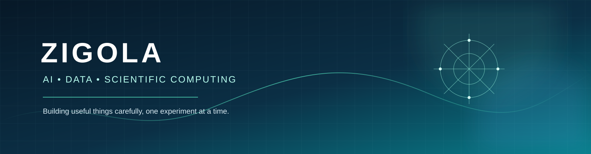

# OPAL_208 · ZIGOLA

### Software Developer | AI Engineer in Progress | Web & Data Technologies

**Python · JavaScript · Web Development · AI & Machine Learning · Data Science · APIs**

  
  
  

[Explore projects](https://github.com/zigola?tab=repositories) · [Professional profile](https://www.linkedin.com/in/ahmed-elinany-6771402b) · [Open an issue](https://github.com/zigola/Zigola/issues)

---

## About

I am **Opal_208 (@zigola)**, focused on **software development, web technologies, artificial intelligence, and data-driven applications**.

I build and document practical projects using **Python, JavaScript, APIs, machine learning, NLP, computer vision, and geospatial technologies**. My focus is on writing maintainable code, building useful applications, testing ideas, and documenting technical work clearly.

My approach is grounded in four principles:

- **Build with purpose** — Start with a clear problem and a useful outcome.
- **Think scientifically** — Make assumptions explicit and evaluate results carefully.
- **Engineer responsibly** — Prefer readable, maintainable, and testable solutions.
- **Share knowledge** — Document experiments and make collaboration approachable.

## Current focus

- Strengthening Python development, software design, and testing practices.
- Exploring responsible AI, retrieval-augmented generation, NLP, computer vision, and AI agents.
- Developing **PLEIADES**, an experimental wildfire-awareness project using satellite observations and simulated sensor data.
- Building accessible, responsive, and maintainable web applications.
- Improving frontend development, interface implementation, and API integration.

## Featured projects

| Project | What it explores | Stage |
| --- | --- | --- |
| [PLEIADES](https://github.com/zigola/NASA-Space-Challenge-PLEIADES) | Wildfire awareness, NASA FIRMS-compatible data, MODIS/VIIRS observations, geospatial processing, and sensor simulation | Experimental project |
| [Zigola Official Website](https://github.com/zigola/Site-officiel-zigola-) | Responsive personal website and frontend development with HTML, CSS, and JavaScript | Development |
| [AI RAG Starter](https://github.com/zigola/ai-rag-starter-python) | Local-first document retrieval and foundations for retrieval-augmented generation | Learning project |
| [AI Agents Workbench](https://github.com/zigola/ai-agents-workbench) | Tool use, bounded agent workflows, memory, and evaluation concepts | Learning project |
| [Computer Vision Playground](https://github.com/zigola/computer-vision-playground) | Image processing and computer vision experiments with Python and OpenCV | Learning project |
| [NLP Text Classification](https://github.com/zigola/nlp-text-classification) | Text preprocessing, classification baselines, and model evaluation | Learning project |
| [LLM Prompt Engineering Lab](https://github.com/zigola/llm-prompt-engineering-lab) | Reproducible prompt experiments and structured evaluation | Learning project |
| [Developer Tools Learning Lab](https://github.com/zigola/skills-copilot-codespaces-vscode) | GitHub Copilot, Codespaces, VS Code, and AI-assisted development workflows | Learning project |

<strong>Explore all public repositories</strong>

Browse the complete [repository list](https://github.com/zigola?tab=repositories), including projects and experiments that are not featured above.

## Areas of interest

| Area | Topics |
| --- | --- |
| Artificial Intelligence | Machine learning, AI applications, automation, and responsible evaluation |
| Data Science | Data cleaning, exploratory analysis, visualization, and interpretation |
| Python Engineering | Reusable tools, scripts, APIs, testing, and maintainable code |
| Software Engineering | Application architecture, debugging, testing, and maintainable code |
| Web Development | Frontend development, responsive interfaces, accessibility, and API integration |
| Earth Observation | Satellite imagery, remote sensing, geospatial data, and environmental monitoring |
| Open Source | Documentation, collaboration, and community-driven development |

## Technology landscape

**Languages and web:** Python · JavaScript · HTML · CSS · SQL (learning)

**Data and scientific tools:** Pandas · NumPy · scikit-learn · OpenCV · Streamlit · geospatial tooling

**Engineering practices:** Git · GitHub · pytest · REST APIs · Markdown · GitHub Actions

> This list reflects technologies used or explored across projects. It is not a claim of equal proficiency in every tool.

## How I work

1. **Understand the problem** — Define the objective, constraints, and assumptions.
2. **Build a small experiment** — Prefer a focused, testable first version.
3. **Validate the result** — Use tests, representative data, and explicit limitations.
4. **Document the work** — Explain setup, usage, architecture, and known gaps.
5. **Iterate openly** — Improve through feedback and evidence.

## Open-source collaboration

Constructive contributions are welcome, especially improvements to:

- Documentation and reproducible examples.
- Tests, data validation, and error handling.
- Accessibility, usability, and maintainability.
- Scientific clarity and responsible-use guidance.

Please check the contribution instructions in the relevant repository. For larger changes, open an Issue first so the proposal can be discussed.

## GitHub

  
  
  

Follow [@zigola](https://github.com/zigola) to follow future project updates. GitHub activity and repository statistics are shown by GitHub itself and may change over time.

## Connect

- **GitHub:** [github.com/zigola](https://github.com/zigola)
- **LinkedIn:** [Professional profile](https://www.linkedin.com/in/ahmed-elinany-6771402b)
- **Behance:** Web design and UI/UX portfolio link to be added.

---

**Explore · Experiment · Engineer · Evolve**

*Building software, exploring technology, and contributing through code.*

